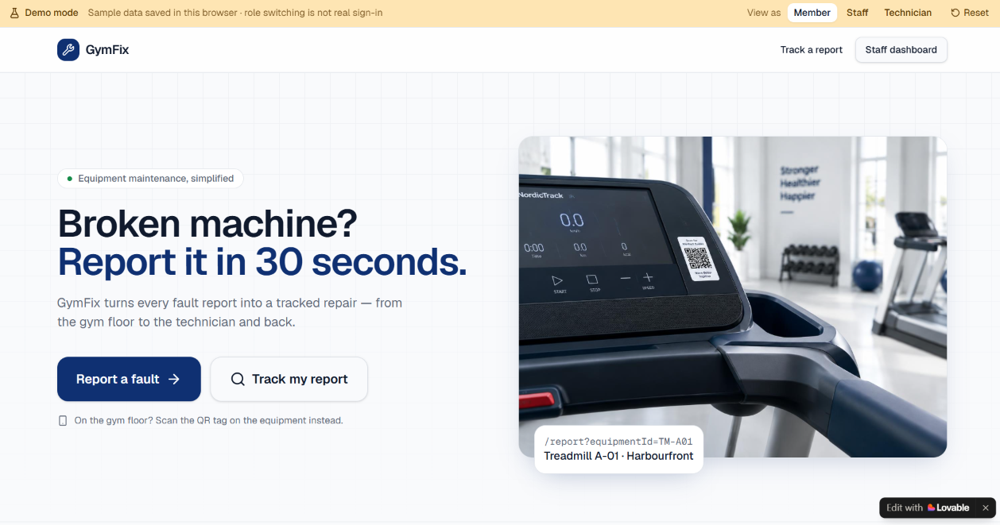
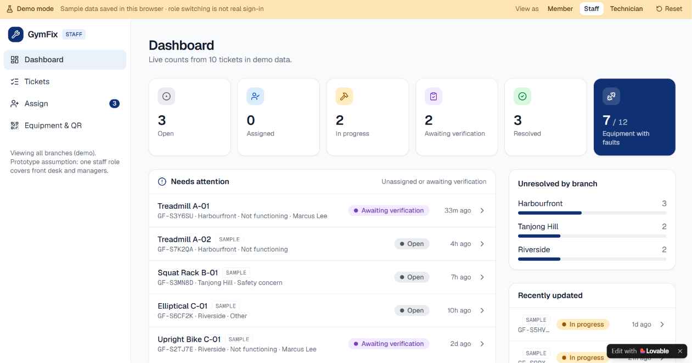
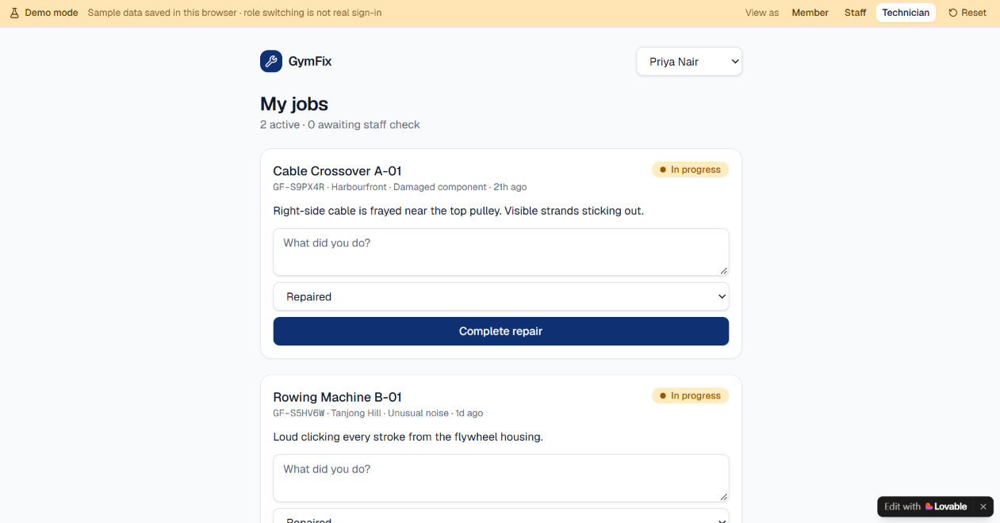

# GymFix — Product Management Case Study

### From Problem Discovery to MVP Development

GymFix is an independent Product Management portfolio project exploring how gym equipment fault reporting, maintenance tracking, and repair visibility can be improved through a digital solution.

**Role:** Product Manager (Independent Project)  
**Project Type:** End-to-End Product Management Case Study  
**Status:** Case Study Completed | Prototype MVP
**Tools:** GitHub, Lovable, Notion, Excel / Google Sheets

---

## 1. Project Overview

Gym members may encounter faulty equipment without a convenient way to report issues or track repair progress. Meanwhile, gym operators may struggle with maintenance coordination, equipment downtime, and communication.

GymFix explores whether a lightweight, mobile-first maintenance management system can improve these experiences.

The project follows an end-to-end Product Management process, from identifying user problems to defining an MVP, building a functional prototype, and evaluating its usability.

## 2. Product Management Process

| Phase | Deliverable | Status |
|---|---|---|
| 01. Problem Discovery | Research and competitor analysis | Completed |
| 02. User Research | Personas, JTBD, user journeys | Completed |
| 03. Product Strategy | Vision, value proposition, KPIs | Completed |
| 04. Prioritisation | RICE framework, MVP scope | Completed |
| 05. Product Requirements | PRD, user stories, acceptance criteria | Completed |
| 06. Design & Prototype | User flows, Lovable MVP | Completed |
| 07. Testing & Iteration | Usability testing, product improvements | Completed (Simulated Evaluation) |
| 08. Roadmap & Learnings | Future roadmap, reflection | Completed |

## 3. Research Approach

This project uses publicly available customer discussions, industry research, and competitive analysis to investigate potential problems in gym equipment maintenance.

Findings from secondary research will be distinguished from assumptions and hypothetical product targets.

## 4. MVP Solution

GymFix is an interactive, browser-based prototype that demonstrates a complete equipment fault reporting and maintenance tracking workflow.

### Core Features

- **Equipment Fault Reporting:** Members can report faulty equipment and receive unique ticket references.
- **Maintenance Dashboard:** Staff can view and manage equipment maintenance tickets.
- **Technician Assignment:** Staff can assign maintenance tasks to technicians.
- **Repair Status Tracking:** Members can check the progress of reported faults.
- **Role-Specific Interfaces:** Dedicated views for gym members, staff, and maintenance technicians.
- **Browser-Based Persistence:** Demo tickets remain available after refreshing the page.

The prototype focuses on the core reporting-to-resolution workflow. Advanced analytics, predictive maintenance, and automated notifications were intentionally excluded from the initial MVP.
## 5. Project Documentation

### Phase 1 — Problem Discovery
- [Problem Discovery Report](01-problem-discovery/discovery-report.md)

### Phase 2 — User Research
- [User Personas](02-user-research/user-personas.md)
- [Jobs-to-Be-Done](02-user-research/jobs-to-be-done.md)
- [User Journey Map](02-user-research/user-journey-map.md)

### Phase 3 — Product Strategy
- [Product Vision & Strategy](03-product-strategy/product-vision.md)
- [Value Proposition](03-product-strategy/value-proposition.md)
- [North Star Metric & KPIs](03-product-strategy/north-star-and-kpis.md)

### Phase 4 — Feature Prioritisation

- [RICE Prioritisation Matrix](04-feature-prioritisation/GymFix_Phase4_RICE_Prioritisation.xlsx)
- [Prioritisation Report](04-feature-prioritisation/GymFix_Phase4_Prioritisation_Report.md)
- [MVP Scope & Trade-offs](04-feature-prioritisation/GymFix_Phase4_MVP_Scope.md)

### Phase 5 — Product Requirements

- [Product Requirements Document](05-product-requirements/PRD.md)
- [User Stories & Acceptance Criteria](05-product-requirements/User_Stories_and_Acceptance_Criteria.md)
- [Functional Requirements](05-product-requirements/Functional_Requirements.md)
- [Lovable Build Specification](05-product-requirements/Lovable_Build_Spec.md)

### Phase 6 — Design & Prototype

- [Prototype Documentation](06-design-and-prototype/README.md)
- [Live GymFix Demo](https://gymfix-demo.lovable.app/)

### Phase 7 — Usability Testing & Iteration

- [Simulated Usability Evaluation](07-usability-testing/simulated-usability-report.md)

### Phase 8 — Product Roadmap & Learnings

- [Product Roadmap](08-roadmap-and-learnings/product-roadmap.md)
- [Key Learnings & Reflection](08-roadmap-and-learnings/key-learnings.md)
- [Final PM Case Study](08-roadmap-and-learnings/final-case-study.md)

## 6. Prototype

### GymFix — Interactive MVP

GymFix is a functional, browser-based prototype developed using Lovable to demonstrate the end-to-end gym equipment maintenance workflow.

**[View Live GymFix Prototype](https://gymfix-demo.lovable.app/)**
### Prototype Screenshots

#### Gym Member — Reporting Experience

#### Gym Staff — Maintenance Dashboard

#### Maintenance Technician — Repair Management

### Key Features

- **Equipment Fault Reporting:** Members can submit equipment-specific fault reports and receive unique ticket IDs.
- **Maintenance Dashboard:** Gym staff can view and manage reported equipment faults.
- **Technician Assignment:** Staff can assign maintenance tickets to technicians.
- **Repair Status Tracking:** Members and staff can monitor maintenance progress.
- **Role-Based Demo Views:** Switch between Member, Staff, and Technician interfaces.
- **Browser-Based Persistence:** Demo tickets remain available after refreshing the page.

### Functional Validation

The prototype successfully passed **7 out of 7 manual functional checks**, including fault submission, technician assignment, ticket status updates, and browser-storage persistence.

**Note:** GymFix currently operates in demo mode using browser-based storage. Role switching is for demonstration purposes and does not represent production authentication or multi-user access.

[View Phase 6 Documentation](06-design-and-prototype/README.md)

---

## 7. Outcomes & Key Learnings

### Project Outcomes

- Completed an **8-phase Product Management case study**, covering problem discovery, user research, product strategy, feature prioritisation, requirements definition, prototyping, evaluation planning, and roadmap development.
- Conducted secondary research using publicly available gym-member discussions and competitor analysis.
- Developed evidence-informed user personas, Jobs-to-Be-Done statements, and user journey maps.
- Applied the **RICE prioritisation framework** to define a focused MVP scope.
- Created a Product Requirements Document (PRD), user stories, and acceptance criteria.
- Built and published an interactive GymFix prototype using Lovable.
- Successfully completed **7/7 manual functional checks**.
- Developed a simulated usability evaluation to demonstrate KPI analysis and iteration planning.

### Key Learnings

1. **Problem Discovery:** Understanding the underlying problem is essential before deciding what features to build.
2. **Data-Driven Prioritisation:** Frameworks such as RICE help structure product decisions, but estimates must be distinguished from actual evidence.
3. **MVP Scope Management:** Prioritising essential workflows helps avoid unnecessary product complexity.
4. **Product Validation:** A functional prototype demonstrates technical feasibility but does not establish product-market fit.
5. **Continuous Iteration:** Testing, feedback, and clearly defined success metrics are important for guiding future improvements.

### Next Steps

- Conduct real usability testing with gym members and operators.
- Validate the proposed product value with potential customers.
- Explore shared database storage and authentication for a future pilot.
- Evaluate additional features based on validated user needs.

**[Read the Full Product Management Case Study](08-roadmap-and-learnings/final-case-study.md)**

---

*This is an independent Product Management portfolio case study and is not affiliated with any gym operator. Secondary research, hypothetical estimates, and simulated evaluations are identified separately from observed results.*
